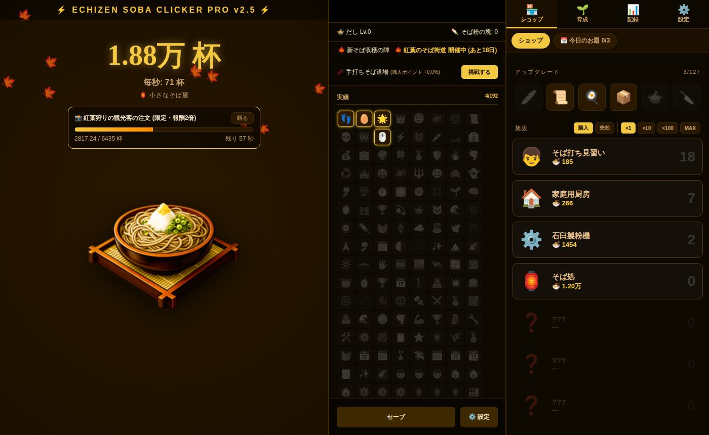
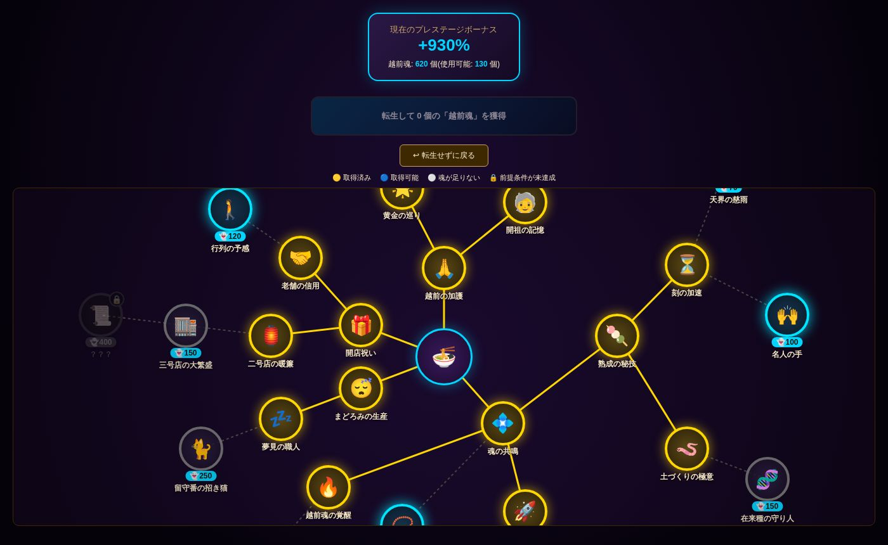
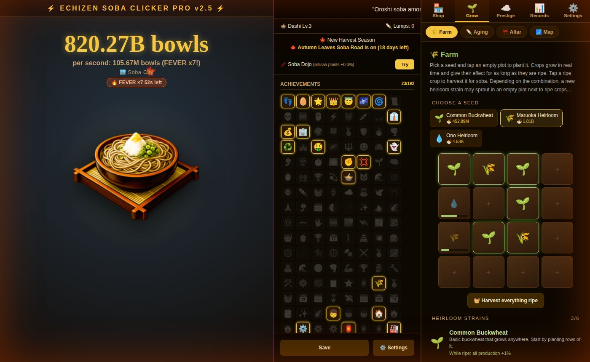
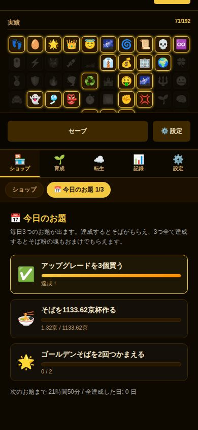

# 越前そばクリッカー / Echizen Soba Clicker

福井の越前そばをひたすら打ち続ける、ブラウザで遊べる放置系クリッカーゲームです。
インストール不要で、パソコンでもスマホでも遊べます。日本語と英語に対応しています。

An idle clicker game about making Echizen soba, the buckwheat noodles of Fukui, Japan.
It runs in the browser on computers and phones, with no install. Available in Japanese and English.

**▶ 遊ぶ / Play: https://amanogawatyoppu-sudo.github.io/Soba-Clicker/**

| | |
|---|---|
|  |  |
|  |  |

## 日本語

### 遊び方
1. 真ん中のそばをクリック(スペースキーでもOK)して、そばを打ちます。
2. たまったそばで「施設」を買うと、自動でそばが増えていきます。
3. アップグレードで効率を上げ、累計1兆杯を超えたら「転生」して、ずっと続く強化「越前魂」を手に入れます。

### おもな要素
- **施設24種・アップグレード**: そば打ち見習いから宇宙そば農場、そして「あなた」まで。
- **転生と天界の力**: 越前魂で買える、35項目のスキルツリー。
- **神格**: 越前魂を1000個集めると行える、転生のさらに上の段階。全てを捧げて「神徳」を得る、終盤の目標です。
- **今日のお題**: 毎日3つ出る日替わりのお題。全部達成するとおまけつき。
- **ゴールデンそば・フィーバー**: ときどき現れる幸運のそば。
- **お客さんの注文**: 制限時間内に注文の杯数を作ると、報酬と評判がもらえます。
- **そば畑**: 現実の時間で育つそば畑。丸岡在来・大野在来など、福井の在来種を交配で見つけよう。
- **福井ご当地MAP**: 勝山・大野・敦賀などに支店を出して、土地ごとのボーナスを獲得。
- **祭壇・手打ちそば道場・熟成**: 精霊の組み合わせ、タイミングゲーム、施設の強化。
- **挑戦モード**: クリック禁止・アップグレード禁止・60分の時間制限など、特別なルールでの挑戦。
- **季節と期間限定イベント**: 現実の暦に合わせたGW・お盆・紅葉・新そば祭り・年越しそば。
- **その他**: ログインボーナス、実績190個以上、BGMと効果音、進み具合のシェア画像、セーブの書き出し・読み込み、ホーム画面に追加してオフラインでも遊べます。

セーブはブラウザ内に自動で保存されます。別の端末に移すときは「設定」からセーブデータを書き出してください。

## English

### How to play
1. Click the soba in the middle (or press Space) to make soba.
2. Spend it on buildings, which then make soba for you.
3. Buy upgrades, and once you pass 1 trillion bowls, prestige for Echizen Souls, a bonus that lasts forever.

### Features
- **24 buildings and upgrades**, from a soba apprentice to a space soba farm, and finally "you".
- **Prestige and heavenly powers**: a 35-node skill tree bought with Echizen Souls.
- **Divinity**: a step beyond prestige at 1,000 souls. Offer everything for divine virtue, a late-game goal.
- **Today's tasks**: three new tasks every day, with a bonus for finishing them all.
- **Golden soba and Fever Time**: lucky soba that shows up now and then.
- **Customer orders**: make the ordered amount in time for a reward and reputation.
- **Soba farm**: crops that grow in real time. Cross-breed them to discover Fukui heirloom strains.
- **Fukui map**: open branches in Katsuyama, Ono, Tsuruga and more, each with its own bonus.
- **Altar, soba dojo and aging**: spirit combinations, a timing minigame and building upgrades.
- **Challenge mode**: special rules such as no clicking, no upgrades or a 60-minute time limit.
- **Seasons and limited-time events** that follow the real calendar.
- **And more**: login bonus, 190+ achievements, music and sound, a shareable progress image, save export and import, and home-screen install for offline play.

Your progress is saved in the browser automatically. To move to another device, export your save from Settings.

## 開発 / Development

素のHTML・CSS・JavaScriptだけで作られています。ビルドは不要で、`soba_clicker.html` をブラウザで開けば動きます。
Plain HTML, CSS and JavaScript with no build step: open `soba_clicker.html` in a browser.

```
js/i18n.js     言語の切り替え / language support
js/lang-en.js  英語の翻訳 / English translations
js/data.js     ゲームデータ / game data
js/core.js     生産・表示・操作 / production, rendering, actions
js/systems.js  画面切り替え・注文・畑・お題など / navigation, orders, farm, daily tasks…
js/save.js     セーブと起動 / saving and startup (loaded last)
tests/         ブラウザテスト / browser tests
```

テストの実行 / Run the tests:

```
npm ci
npx playwright install chromium
npm test
```
